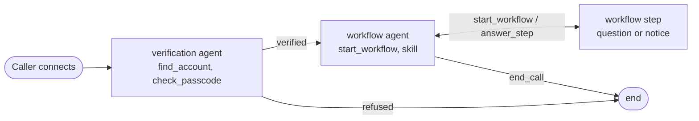
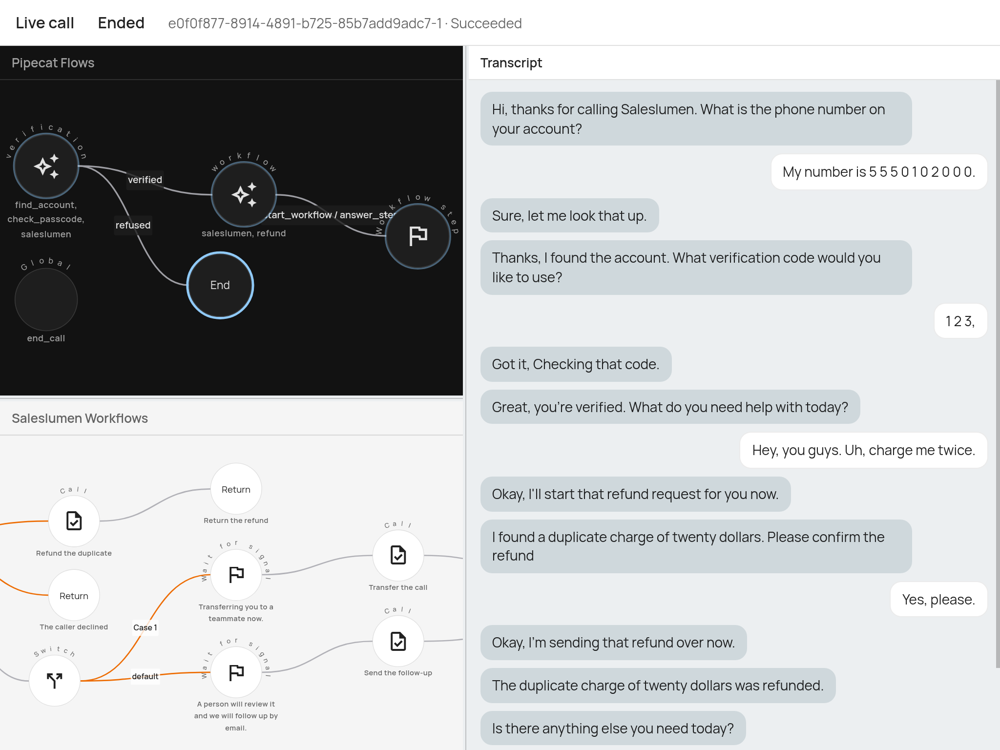
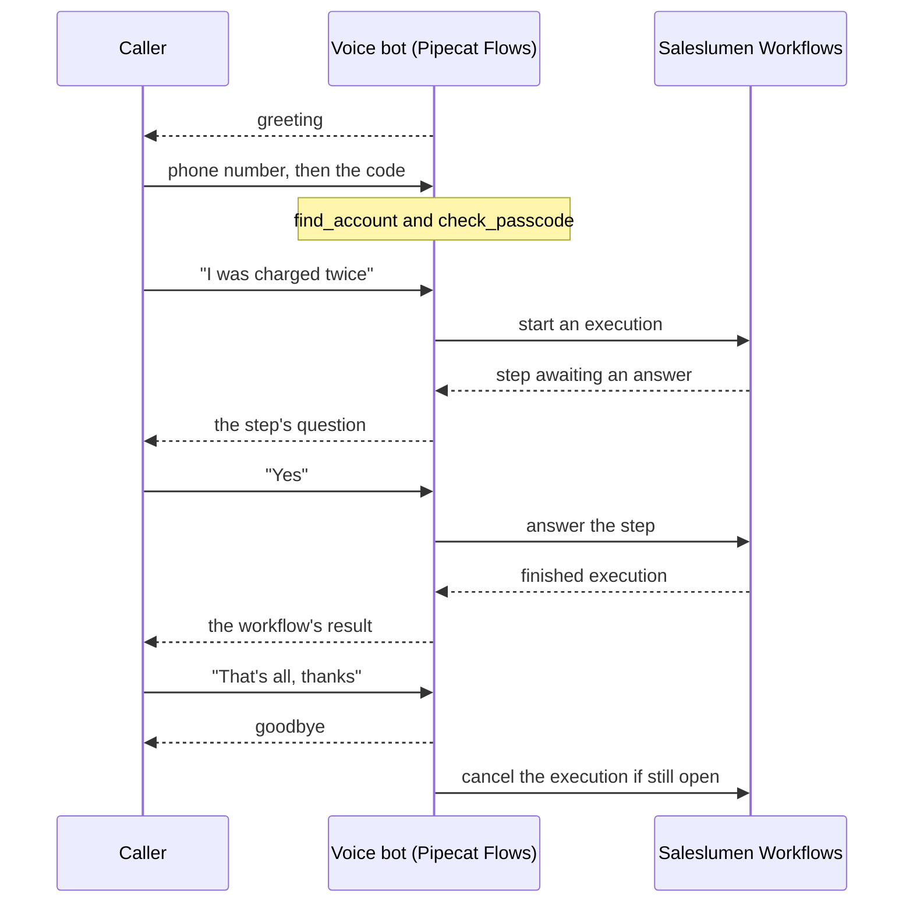
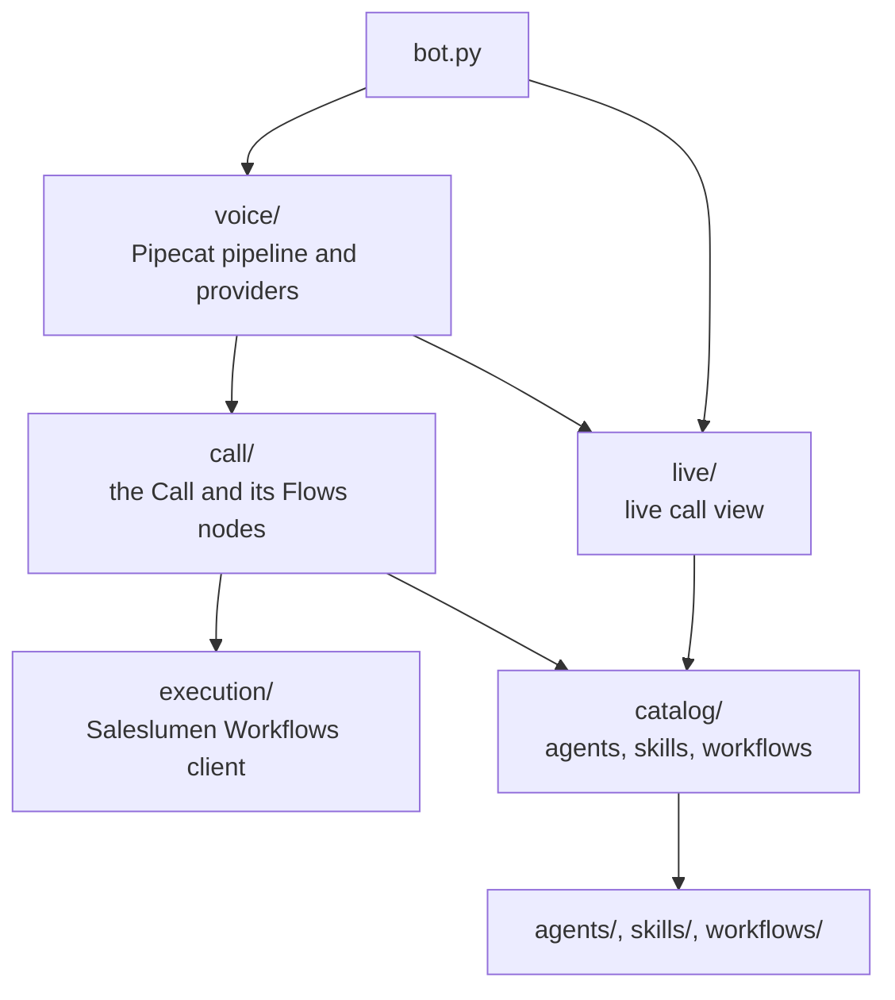

# Deepgram and Saleslumen Voice Demo

A browser voice agent that verifies a caller and then runs a Saleslumen workflow for them. Deepgram handles speech and the model (Flux speech-to-text, Flux text-to-speech, and Think). [Pipecat](https://docs.pipecat.ai) 1.17 and Pipecat Flows run the conversation. Saleslumen Workflows runs the business process.

## Overview

A call has two parts:

1. **Verification.** The caller gives the phone number on their account and reads a code. Tools check both against the caller's own words.
2. **Help.** The caller says what they need. The agent starts a workflow, reads each workflow question word for word, sends the answer back, and reads the result.

The model never decides an outcome. Tools decide verification, and the workflow decides the result.



Each box is a Pipecat Flows node. `end_call` is available on every node, and a second idle timeout also ends the call.

## Quickstart

You need Python 3.13, [uv](https://docs.astral.sh/uv/), a Deepgram API key, and a Saleslumen API key with access to the refund workflow.

1. Install dependencies.

   ```bash
   uv sync
   ```

2. Create `.env` and set `DEEPGRAM_API_KEY`, `SALESLUMEN_API_KEY`, `SALESLUMEN_ORGANIZATION_ID`, and `SALESLUMEN_WORKFLOW_ID`. See [Configuration](#configuration).

   ```bash
   cp .env.example .env
   ```

3. Start the bot.

   ```bash
   uv run python bot.py -t webrtc
   ```

4. Open <http://localhost:7860> and connect.

5. Say the demo account number **555 010 2000**, read the code **one, two, three**, and then say you were charged twice.

## Watch a call live

Open <http://localhost:7860/live> in a second tab during a call. The page is read-only and follows the latest call.



- The top pane shows the Pipecat flow. The active node is highlighted, and a pulse runs along each branch the call takes.
- The bottom pane shows the running Saleslumen workflow and the step it is waiting on.
- The right column shows the transcript.

Drag inside a pane to pan, scroll to zoom, and double-click to fit. Drag the dividers to resize. The transcript goes only to this local page and is never logged.

## How a call works



- **Verification.** Digits count only when they appear in the caller's latest words. Three misses end the call.
- **Workflow steps.** A question step reads its label and waits for the answer. A notice step reads its label and continues.
- **Goodbye.** The agent says goodbye once, in the same reply that ends the call.
- **Idle.** After eight seconds of silence the bot asks "Are you still there?" A second silence ends the call.
- **Hang up.** Ending or dropping the call cancels any open execution.

## Configuration

`bot.py` loads `.env`, and `config.py` validates every key at startup.

| Key | Default | Notes |
| --- | --- | --- |
| `DEEPGRAM_API_KEY` | required | |
| `DEEPGRAM_VOICE` | `flux-alexis-en` | Must be a Flux voice |
| `DEEPGRAM_LLM_MODEL` | `think-fast` | |
| `STT_PROVIDER` | `deepgram-flux` | |
| `TTS_PROVIDER` | `deepgram-flux` | |
| `LLM_PROVIDER` | `deepgram` | `deepgram` or `openrouter` |
| `OPENROUTER_API_KEY` | empty | Required for `LLM_PROVIDER=openrouter` and for evals |
| `OPENROUTER_MODEL` | `openai/gpt-4.1` | |
| `SALESLUMEN_API_KEY` | required | |
| `SALESLUMEN_ORGANIZATION_ID` | required | |
| `SALESLUMEN_NAMESPACE_ID` | empty | |
| `SALESLUMEN_API_DOMAIN` | `saleslumenapis.com` | Host name only |
| `SALESLUMEN_WORKFLOW_ID` | `hello-voice` | The refund workflow |

## Testing

Run the unit tests:

```bash
uv run python -m unittest discover -s tests -t .
```

Run the [Pipecat evals](evals/). The suite starts the bot itself and uses OpenRouter for the judge and the simulated callers:

```bash
uv run pipecat eval suite evals/suite.yaml
```

The evals run in text mode. They check flow nodes and function calls, not the model's wording.

## Project layout



| Path | Contents |
| --- | --- |
| `bot.py` | Entry point for the Pipecat runner |
| `config.py` | Typed environment settings |
| `voice/` | Pipeline, speech and model providers, MCP connectors |
| `call/` | The `Call` and every Flows node it builds |
| `execution/` | Saleslumen Workflows client and `Run` |
| `catalog/` | Loads and validates agents, skills, and workflows |
| `live/` | The live call view |
| `agents/` | Shared prompt, pipeline, and one directory per agent |
| `skills/` | Skill markdown |
| `workflows/refund/` | The refund workflow revision and Apps Script |
| `evals/` | Scripted calls and simulated callers |
| `tests/` | Unit tests |

## Publishing the refund workflow

Use a Saleslumen API key with `workflows.read` and `workflows.write`. Keep the deployment id local and never commit it.

1. Create the Apps Script project, upload `workflows/refund/script/`, and deploy it.

   ```bash
   sl auth login
   sl script projects create --json
   sl script content get --project SCRIPT_ID --json
   sl script content update --project SCRIPT_ID --input workflows/refund/script/content.json --json
   sl api script /v1/projects/SCRIPT_ID/versions -X POST --input version.json
   sl script deployments create --project SCRIPT_ID --version-number VERSION_NUMBER --deployment-type DEPLOYMENT_TYPE_EXECUTION_API --description prod --json
   ```

2. Copy `workflows/refund/revision.json` and replace `scripts/REPLACE_WITH_DEPLOYMENT_ID` with `scripts/<deployment-id>`.

3. Create the revision, check `validationErrors`, and deploy it. Redeploy after every revision change.

   ```bash
   sl workflows revisions create --workflow WORKFLOW_ID --revision-id REVISION_ID --input revision.json --json
   sl workflows deploy WORKFLOW_ID --revision workflows/WORKFLOW_ID/revisions/REVISION_ID --json
   ```

## Learn more

- [CONTRIBUTING.md](CONTRIBUTING.md): add or change agents, tools, connectors, skills, and workflows.
- [AGENTS.md](AGENTS.md): how the call, the nodes, and the live view work inside.
